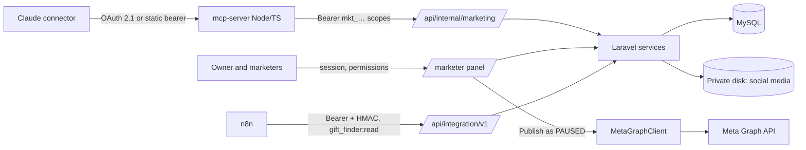

# Marketing system — architecture

How the marketer panel, Claude, n8n and Meta fit together. Owner decisions: `MARKETER_PLAN.md` §1. External setup: `implementation_steps_of_mcp.docx` (repo root).

## Rules the design enforces
- **Laravel is the source of truth.** The MCP server and n8n never touch the database. Every write is validated again in Laravel.
- **Claude drafts, people decide.** There is no API route or MCP tool to approve, reject, apply, roll back, publish or activate. Those actions exist only in `routes/marketer.php`, behind permissions and CSRF.
- **Meta client lives in Laravel.** The token never reaches the MCP server. Writes are limited to creating objects as PAUSED; no activate, budget update or delete path exists.
- **Approvals are bound to content.** Suggestions and Meta drafts are approved for one version and content hash; any edit cancels the approval.

## Components
| Part | Code | Docs |
|---|---|---|
| Marketer panel | `routes/marketer.php`, `App\Support\Marketing\MarketerNav`, `resources/views/marketer/` | [MARKETER_PANEL.md](MARKETER_PANEL.md) |
| Marketing API | `routes/api_marketing.php`, middleware `marketing.token:{scope}` | [API_DOCUMENTATION.md](API_DOCUMENTATION.md) |
| Suggestions engine | `app/Services/Marketing/Suggestions/` | [AI_SUGGESTIONS_ARCHITECTURE.md](AI_SUGGESTIONS_ARCHITECTURE.md), [SUGGESTION_LIFECYCLE.md](SUGGESTION_LIFECYCLE.md), [APPROVAL_AND_EXECUTION_ENGINE.md](APPROVAL_AND_EXECUTION_ENGINE.md) |
| SEO, blog, themes | suggestion type handlers | [SEO_MODULE.md](SEO_MODULE.md), [BLOG_CONTENT_WORKFLOW.md](BLOG_CONTENT_WORKFLOW.md), [SEASONAL_THEME_MANAGEMENT.md](SEASONAL_THEME_MANAGEMENT.md) |
| Social media library | `App\Services\Marketing\Media\SocialMediaLibraryService` | [SOCIAL_MEDIA_LIBRARY.md](SOCIAL_MEDIA_LIBRARY.md), [MEDIA_GENERATION.md](MEDIA_GENERATION.md) |
| Meta drafts and publish | `App\Services\Marketing\Meta\*`, `config/meta.php` | [META_INTEGRATION.md](META_INTEGRATION.md) |
| MCP server | `mcp-server/` (separate Node service) | [MCP_TOOLS.md](MCP_TOOLS.md), `mcp-server/README.md` |
| n8n gift-finder flow | `n8n/` (self-hosted, no Docker), `routes/api_integration.php` | `n8n/README.md`, [`docs/api/integration.md`](../api/integration.md) |

Security controls: [SECURITY.md](SECURITY.md). Deployment: [DEPLOYMENT.md](DEPLOYMENT.md). Tests: [TESTING.md](TESTING.md).

## Two separate APIs
| | `/api/internal/marketing` | `/api/integration/v1` |
|---|---|---|
| Caller | MCP server | n8n |
| Auth | Bearer service token `mkt_…` | Bearer + timestamp + HMAC signature |
| Managed at | `/marketer/api-tokens` | `/marketer/integration-clients` |
| Writes | Create and edit drafts, submit for review | None |

## Scheduled jobs (`routes/console.php`)
`integration:prune` 03:10, `marketing:prune-requests` 03:15, `marketing:expire-suggestions` 03:25. n8n workflow schedules are listed in `n8n/README.md`. n8n does not generate suggestions.
