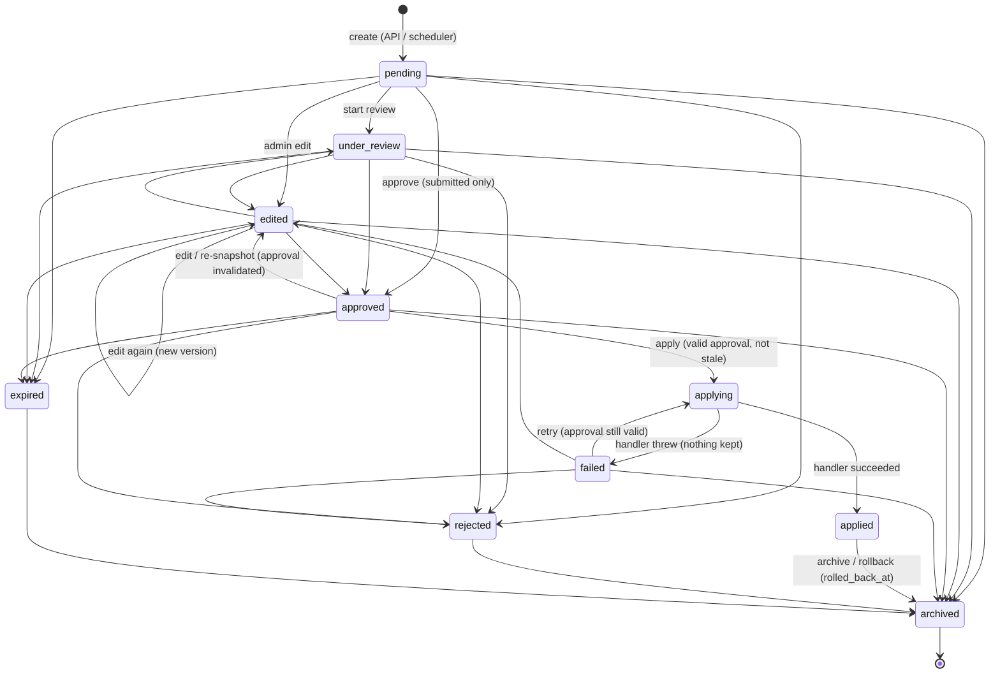

# Suggestion lifecycle (P5, MCP.md §16.3)

Statuses (`App\Enums\Marketing\SuggestionStatus`); allowed moves are the only ones `App\Services\Marketing\Suggestions\SuggestionStateMachine`
accepts — anything else is refused with `409 illegal_transition` (API) / an error toast (panel).

| Rule | Where |
|---|---|
| Editing never applies anything; each edit = `version + 1` + a revision row (who, diff, note). | `SuggestionEngine::update` |
| An admin edit moves the suggestion to `edited`; a token edit (API, own `pending`/`edited` only) keeps the status. | engine |
| Approval is explicit, by a permitted admin, bound to `(version, content_hash)`, valid `marketing.suggestions.approval_valid_hours` (168 h). | `approve()` |
| Any edit (or re-snapshot) after approval invalidates it (`invalidated_at`, reason) and returns to `edited`. | `update()`, `resnapshot()` |
| A draft created with `draft: true` must be submitted (`POST …/submit`) before it can be approved. | `approve()` |
| Apply requires a valid, unexpired approval of the current version + hash and an unchanged target (stale check). | `apply()` |
| Apply is idempotent (same key ⇒ same execution; applied ⇒ never applied again). A failure ⇒ `failed`, never `applied`. | `apply()` |
| Rollback (where supported) = `applied → archived` + `rolled_back_at` + a `rollback` execution. | `rollback()` |
| Expiry: daily `marketing:expire-suggestions` (03:25) moves open suggestions past `expires_at` (default +60 days) to `expired`. | `expireDue()` |
| A rejected suggestion cannot be re-created (same type + target + payload hash) for 30 days unless `force_reason` is given. | `create()` |
| Every action is logged in `marketing_suggestion_activity_logs` (created, edited, submitted, review_started, approved, rejected, conflict, applied, failed, rolled_back, published, scheduled, resnapshotted, archived, expired). | `log()` |
